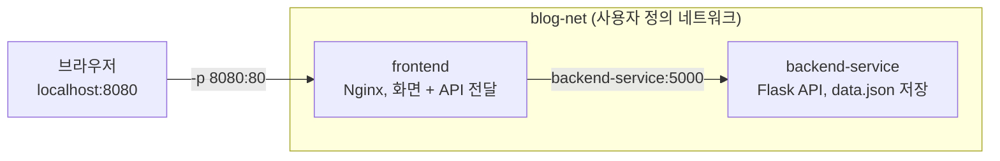

# 실습 5. 미니 블로그 띄우기

!!! abstract "이번 실습에서 할 것"
    - 사용자 정의 네트워크를 만들고 frontend, backend 두 컨테이너를 붙입니다.
    - 두 컨테이너가 **이름으로** 통신하는 서비스를 만듭니다.

**소요 시간** 약 12분, **교안** DAY 1 섹션 5

## 준비

미니 블로그 구조입니다. 이 앱을 5일차에 쿠버네티스로 그대로 옮깁니다.



- 브라우저는 `frontend`의 8080 포트로 들어옵니다.
- `frontend`는 글 저장 요청을 **`backend-service`라는 이름**으로 백엔드에 넘깁니다.
- 백엔드는 밖에 포트를 열지 않습니다.

!!! info "localhost 는 누구를 가리킬까"
    | 어디서 | localhost 는 |
    |---|---|
    | PC 브라우저 | 내 PC. `-p 8080:80` 포트 전달로 frontend 컨테이너에 닿습니다 |
    | frontend 컨테이너 안 | frontend 자신. 백엔드가 아닙니다 |

    그래서 frontend는 `localhost:5000`이 아니라 **`backend-service:5000`** 으로 백엔드를 부릅니다. 브라우저가 `backend-service` 이름을 직접 찾는 것이 아니라, 브라우저는 frontend에만 요청하고 frontend의 Nginx가 백엔드로 전달합니다.

실습 1의 `web` 컨테이너가 8080을 쓰고 있으니 **먼저 지웁니다.**

```bash
docker rm -f web
```

!!! info "이미지 태그는 v4-kb5"
    1일차 도커 실습은 `v4-kb5` 태그를 씁니다. 이 frontend는 같은 네트워크의 `backend-service`라는 짧은 이름으로 백엔드를 부르고, Windows(Intel)와 Apple Silicon Mac을 모두 지원합니다. 5일차 쿠버네티스 실습은 다른 태그(`v3-kb5`)를 씁니다.

## STEP 1. 전용 네트워크

```bash
docker network create blog-net
```

```text
5b8e2f1c9a7d4e3b2a1f0e9d8c7b6a5f4e3d2c1b0a9f8e7d6c5b4a3f2e1d0c9b
```
<small>출력은 예시입니다.</small>

## STEP 2. backend 먼저 (이름 필수, 포트 공개 안 함)

이름은 반드시 **`backend-service`** 입니다. frontend가 이 이름으로 백엔드를 찾도록 만들어져 있습니다.

```bash
docker run -d --name backend-service --network blog-net skilleat/backend:v4-kb5
```

## STEP 3. frontend

같은 네트워크에 붙이고 내 PC 8080을 엽니다.

```bash
docker run -d --name frontend --network blog-net -p 8080:80 skilleat/frontend:v4-kb5
```

```bash
docker ps
```

```text
CONTAINER ID   IMAGE                      COMMAND                  CREATED          STATUS          PORTS                  NAMES
7a6b5c4d3e2f   skilleat/frontend:v4-kb5   "/docker-entrypoint.…"   5 seconds ago    Up 4 seconds    0.0.0.0:8080->80/tcp   frontend
1f2e3d4c5b6a   skilleat/backend:v4-kb5    "python app.py"          20 seconds ago   Up 19 seconds   5000/tcp               backend-service
```
<small>출력은 예시입니다. ID, COMMAND, 시간은 사람마다 다릅니다.</small>

`backend-service`의 PORTS에는 `0.0.0.0:...->`가 없습니다. 밖에서는 접근할 수 없고 같은 네트워크의 frontend만 접근합니다.

**브라우저에서 `http://localhost:8080`** 을 열고 글을 하나 써서 등록합니다. 목록에 글이 보이면 frontend와 backend가 이름으로 통신한 것입니다.

화면 HTML이 오는지만 터미널로 확인하려면 아래처럼 합니다. 글 쓰기 확인은 브라우저로 합니다.

=== "Windows (PowerShell)"

    ```powershell
    curl.exe http://localhost:8080
    ```

=== "Mac (터미널)"

    ```bash
    curl http://localhost:8080
    ```

## STEP 4. 같은 네트워크인지 확인

```bash
docker network inspect blog-net
```

```text
[
    {
        "Name": "blog-net",
        "Driver": "bridge",
        ...
        "Containers": {
            "1f2e3d4c...": {
                "Name": "backend-service",
                "IPv4Address": "172.18.0.2/16",
                ...
            },
            "7a6b5c4d...": {
                "Name": "frontend",
                "IPv4Address": "172.18.0.3/16",
                ...
            }
        },
        ...
    }
]
```
<small>출력은 예시입니다. ID와 IP는 사람마다 다릅니다.</small>

`Containers` 안에 `backend-service`와 `frontend` 두 개가 있으면 됩니다.

??? info "더 보기: 저장된 글은 어디에 있나"
    백엔드는 글을 컨테이너 안의 파일에 저장합니다.

    ```bash
    docker exec backend-service cat /app/data.json
    ```

    방금 쓴 글이 보입니다. 이 파일은 컨테이너의 쓰기 레이어에 있어서, 컨테이너를 지우면 같이 사라집니다. 4일차 데이터 실습의 출발점입니다.

    !!! note "환경에 따라 다를 수 있음"
        이미지 버전에 따라 경로가 다를 수 있습니다. `No such file or directory`가 나오면 `docker exec backend-service ls /app`으로 폴더를 먼저 봅니다.

## 성공하면

- 브라우저 `localhost:8080`에서 글을 등록하면 목록에 보입니다.
- `docker network inspect blog-net`의 `Containers`에 컨테이너 2개가 있습니다.

## 막히면

!!! tip "명령을 다시 치기 전에 이 순서로 봅니다"
    1. `docker ps -a`: 두 컨테이너가 `Up`인지, `Exited`로 멈췄는지
    2. `docker logs 이름`: 멈췄다면 왜 멈췄는지
    3. `docker network inspect blog-net`: 두 컨테이너가 같은 네트워크에 있는지
    4. `docker port frontend`: 8080이 80에 연결됐는지

    5일차 쿠버네티스 장애 찾기(get, describe, logs, events)도 같은 순서입니다.

??? failure "Bind for 0.0.0.0:8080 failed: port is already allocated"
    실습 1의 `web` 컨테이너가 8080을 쓰고 있습니다. 실패한 frontend도 남아 있으니 둘 다 지우고 STEP 3을 다시 합니다.

    ```bash
    docker rm -f web frontend
    ```

    `web`을 지워도 같은 오류가 나면 다른 프로그램이 8080을 쓰는 것입니다. `-p 8081:80`으로 바꿔 실행하고 `localhost:8081`로 접속합니다. 실습 6의 8080도 그 포트로 바꿔 읽습니다.

??? failure "화면은 뜨는데 글 등록이 실패함"
    백엔드 이름이 `backend-service`가 아니거나, 두 컨테이너가 같은 네트워크에 없습니다.

    - `docker ps`의 NAMES가 정확히 `backend-service`인지 봅니다.
    - `docker network inspect blog-net`에 두 컨테이너가 다 있는지 봅니다.
    - `docker logs backend-service`로 백엔드가 오류로 멈추지 않았는지 봅니다.

    이름이 틀렸으면 지우고 STEP 2부터 다시 합니다.

    ```bash
    docker rm -f backend-service frontend
    ```

??? failure "Error response from daemon: network blog-net not found"
    STEP 1을 건너뛰었습니다. `docker network create blog-net`부터 다시 합니다. 실패한 컨테이너가 남아 있으면 `docker rm -f 이름`으로 지웁니다.

??? failure "Error response from daemon: network with name blog-net already exists"
    네트워크가 이미 있습니다. 그대로 STEP 2로 넘어가면 됩니다.

??? failure "manifest for skilleat/backend:v4-kb5 not found / manifest unknown"
    태그 오타입니다. `skilleat/backend:v4-kb5`와 한 글자씩 비교합니다.

??? failure "Conflict. The container name \"/frontend\" is already in use"
    이전에 실패한 `frontend`가 남아 있습니다. `docker rm -f frontend`로 지우고 다시 실행합니다. `backend-service`도 같습니다.

## 정리

**지우지 마세요.** 실습 6에서 `frontend`, `backend-service`, `blog-net`을 그대로 씁니다.
