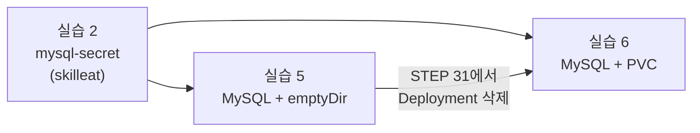

# 4일차 오늘의 실습

!!! abstract "오늘 할 것"
    - 설정은 이미지 밖으로: ConfigMap, Secret으로 넣고 값을 바꾼 뒤 rollout restart 합니다.
    - 상태와 자원은 쿠버네티스에게: readinessProbe를 일부러 실패시키고, 메모리 한도를 넘겨 OOMKilled를 봅니다.
    - 데이터 지키기: MySQL을 emptyDir로 띄워 데이터가 사라지는 것을 보고, PVC로 같은 실험을 다시 합니다.

## 오늘의 실습

| 실습 | 내용 | 교안 | STEP | 시간 |
|---|---|---|---|---|
| [실습 1](lab-1.md) | ConfigMap 만들고 두 방법으로 넣기, 값을 바꿔 환경변수와 파일 비교 | 섹션 1 | 1~6 | 15분 |
| [실습 2](lab-2.md) | Secret 만들고 base64 풀기, 값 바꾸고 rollout restart | 섹션 2 | 7~12 | 12분 |
| [실습 3](lab-3.md) | readinessProbe 실패시키고 EndpointSlice에서 ready: false 보기 | 섹션 3 | 13~18 | 12분 |
| [실습 4](lab-4.md) | 메모리 한도 넘겨 OOMKilled 보기, requests가 너무 커서 Pending 보기 | 섹션 4 | 19~25 | 12분 |
| [실습 5](lab-5.md) | MySQL에 데이터 넣고 Pod를 지우면 사라지는 것 보기 (emptyDir) | 섹션 5 | 26~29 | 12분 |
| [실습 6](lab-6.md) | PVC로 같은 실험을 다시 해서 데이터가 남는 것 보기 | 섹션 6 | 30~34 | 12분 |

## 시작 전에

쿠버네티스가 켜져 있는지 확인합니다. `docker-desktop`이 `Ready`면 됩니다.

```bash
kubectl get nodes
```

```text
NAME             STATUS   ROLES           AGE   VERSION
docker-desktop   Ready    control-plane   3d    v1.3x.x
```
<small>출력은 예시입니다. 이름, IP, 시간은 사람마다 다릅니다.</small>

오늘 실습 폴더를 만들고 이동합니다.

=== "Windows (PowerShell)"

    ```powershell
    mkdir $HOME\k8s-labs\day4; cd $HOME\k8s-labs\day4
    ```

=== "Mac (터미널)"

    ```bash
    mkdir -p ~/k8s-labs/day4 && cd ~/k8s-labs/day4
    ```

VS Code로 이 폴더를 열어 두면 YAML 파일을 만들기 편합니다.

```bash
code .
```

!!! tip "MySQL 이미지는 미리 받아 두세요"
    3교시(실습 5, 6)의 `mysql:8.0` 이미지는 크기가 커서 처음 받는 데 몇 분 걸립니다. 수업 시작할 때 미리 받아 두면 3교시에 기다리지 않습니다.

    ```bash
    docker pull mysql:8.0
    ```

## 오늘 이어서 쓰는 것

!!! warning "mysql-secret은 지우지 마세요"
    실습 2에서 만드는 `mysql-secret`은 실습 5, 6의 MySQL이 root 비밀번호로 그대로 씁니다. 실습 2를 마치면 비밀번호는 `skilleat`입니다. 하루 마지막(실습 6 정리)에 지웁니다.



## 오늘 쓰는 파일

모두 `day4` 폴더에 저장합니다. VS Code로 직접 만들거나 아래 링크로 내려받습니다.

| 파일 | 실습 | 내려받기 |
|---|---|---|
| `cm-pod.yaml` | 실습 1 | [cm-pod.yaml](../files/day4/cm-pod.yaml){ download } |
| `secret-demo.yaml` | 실습 2 | [secret-demo.yaml](../files/day4/secret-demo.yaml){ download } |
| `probe-web.yaml` | 실습 3 | [probe-web.yaml](../files/day4/probe-web.yaml){ download } |
| `memory-hog.yaml` | 실습 4 (Windows, Mac 공통) | [memory-hog.yaml](../files/day4/memory-hog.yaml){ download } |
| `big-request.yaml` | 실습 4 | [big-request.yaml](../files/day4/big-request.yaml){ download } |
| `mysql-emptydir.yaml` | 실습 5 | [mysql-emptydir.yaml](../files/day4/mysql-emptydir.yaml){ download } |
| `mysql-pvc.yaml` | 실습 6 | [mysql-pvc.yaml](../files/day4/mysql-pvc.yaml){ download } |
| `mysql-pvc-deploy.yaml` | 실습 6 | [mysql-pvc-deploy.yaml](../files/day4/mysql-pvc-deploy.yaml){ download } |

## 오늘 쓰는 명령 모음

| 하는 일 | 명령 |
|---|---|
| ConfigMap 만들기 | `kubectl create configmap <이름> --from-literal=KEY=VALUE` |
| Secret 만들기 | `kubectl create secret generic <이름> --from-literal=KEY=VALUE` |
| Secret 값 풀어 보기 | `kubectl get secret <이름> -o go-template="{{.data.KEY | base64decode}}"` |
| Pod 새로 교체 | `kubectl rollout restart deployment/<이름>` |
| 주소 목록 보기 | `kubectl get endpointslices -l kubernetes.io/service-name=<svc> -o yaml` |
| 상태 지켜보기 | `kubectl get pod <이름> -w` |
| 죽은 이유 보기 | `kubectl describe pod <이름>`, `kubectl logs <이름> --previous` |
| MySQL 접속 | `kubectl exec -it deploy/mysql -- mysql -uroot -pskilleat` |
| 저장소 보기 | `kubectl get storageclass`, `kubectl get pvc,pv`, `kubectl describe pvc <이름>` |

## 하루를 마치고 한꺼번에 정리

실습마다 정리를 했다면 할 필요 없습니다. 중간에 빠뜨린 것이 있어도 아래 한 줄이면 오늘 만든 것이 모두 지워집니다 (없는 것은 건너뜁니다).

```bash
kubectl delete deploy/mysql deploy/secret-demo deploy/web-probe svc/web-probe pvc/mysql-pvc secret/mysql-secret cm/app-config pod/cm-pod pod/memory-hog pod/big-request --ignore-not-found
```
